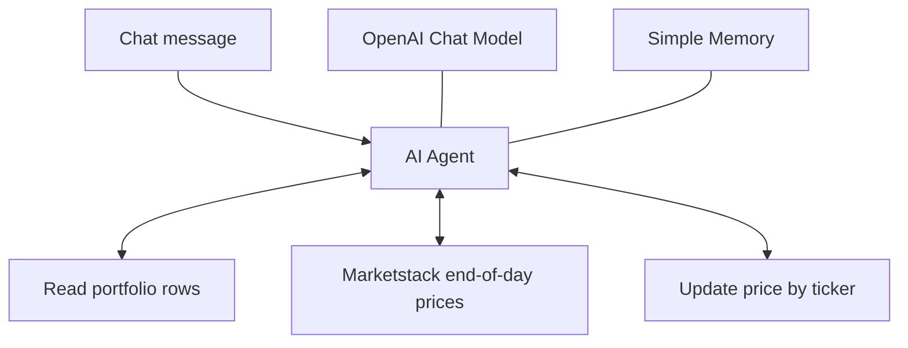

# AI Portfolio Updater

An n8n AI agent that reads a stock portfolio from Google Sheets, fetches the latest available end-of-day prices from Marketstack, and updates the sheet through chat.

## How it works

The agent chooses when to call each tool. Three portfolio rows do not guarantee exactly three market-data calls: retries or corrections can add calls.

## Setup

1. Download `workflow.json` and import it into n8n using **Import from File**.
2. Configure your credentials in the OpenAI, Marketstack, and both Google Sheets nodes.
3. Create a Google Sheet with the headers `Ticker`, `Quantity`, and `Price`. Use valid market symbols, for example:

   | Ticker | Quantity | Price |
   | --- | --- | --- |
   | GOOGL | 3 | |
   | AAPL | 2 | |
   | TSLA | 3 | |

4. In both Google Sheets nodes, replace `YOUR_SPREADSHEET_ID` with your sheet's document ID, or select the document from the list. Select your worksheet in both nodes; the template uses `Sheet1`.
5. Refresh the update node's column mapping if needed. Match on `Ticker` and let the model supply `Ticker` and `Price`. Keep quantity excluded from updates. The original export's removed quantity field contains a trailing space; reselect your sheet columns if your headers differ.
6. Check that the OpenAI model selected in the export (`gpt-5-mini`) is available for your account.
7. Save, open the workflow chat, and test with:

   > Please update the prices in my equity portfolio sheet to reflect the latest available end-of-day market prices. Leave quantities unchanged and report the results.

## Notes

- Marketstack is configured for the latest available end-of-day data, not real-time quotes.
- Use `GOOGL` rather than `GOOGLE` as the example Google ticker. Invalid symbols can cause failed calls and retries.
- This agent can write to your spreadsheet. Test with a sample sheet first.
- Model and market-data usage depend on your provider accounts.

## Shared export

Credential references, spreadsheet IDs and links, the chat webhook ID, and workflow/instance metadata have been removed. Add your own credentials and spreadsheet configuration after import. The workflow is inactive by default, with no pinned execution data.

The JSON and node connections were validated before upload. Live execution requires your configured n8n instance and has not been tested from this repository.
